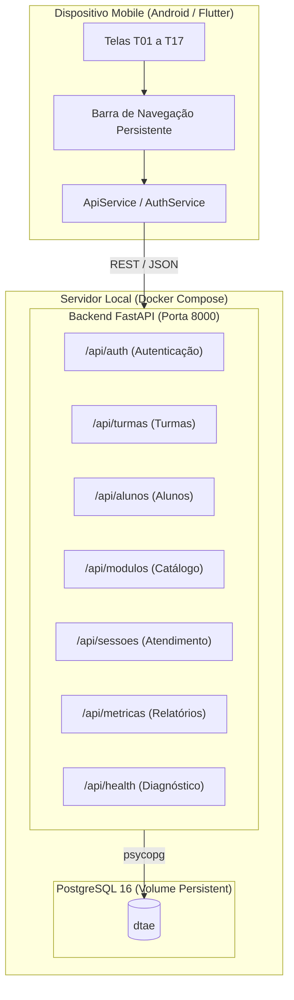
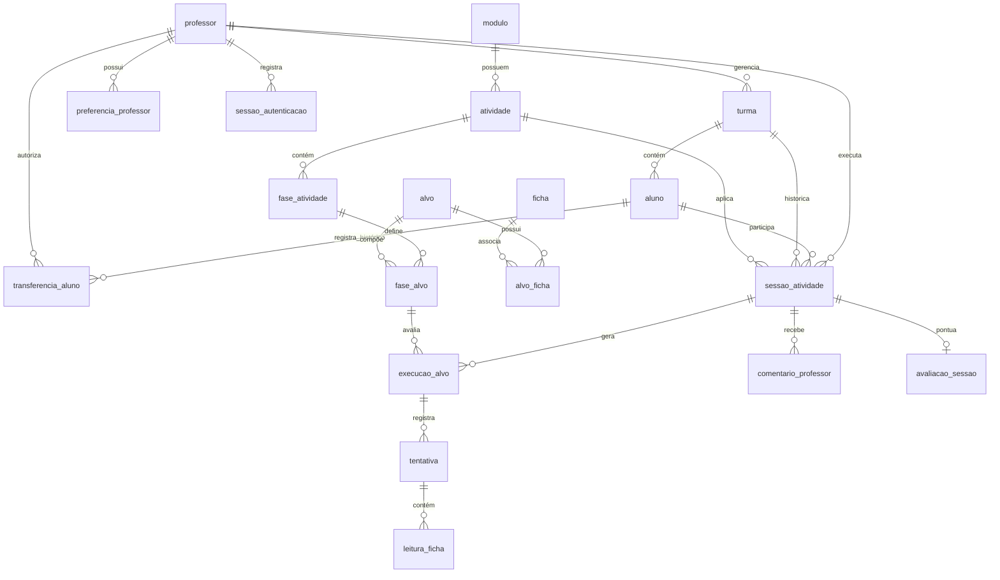

# Relatório Funcional e Arquitetural — Plataforma DTAE (MVP)

> **Documento de Entrega do Projeto MVP**
> **Plataforma:** Android (Flutter / Dart)
> **Backend:** Python / FastAPI (Arquitetura Modular)
> **Banco de Dados:** PostgreSQL 16 Alpine em Docker Compose
> **Versão:** 1.0 — Outubro de 2026

---

## 1. Visão Geral da Arquitetura

O sistema **DTAE** (Apoio à Alfabetização em Braille) foi construído seguindo uma **Arquitetura Modular Desacoplada (Modular Monolith / Microservices-ready)**. A plataforma garante a persistência completa do histórico pedagógico, auditoria de transferências e cálculo automatizado do desempenho DTAE dos alunos.



---

## 2. Módulos e Funcionalidades Implementadas

### 2.1 Autenticação e Perfil do Professor (`T01`, `T02`, `T16`)
- **Cadastro de Professor (RF-001):** Formulário completo com Nome, Sobrenome, E-mail, Senha (criptografada com SHA-256 + salt), Instituição e Especialidade.
- **Login Persistente (RF-002):** Autenticação via e-mail e senha com geração de token JWT Bearer e gravação da sessão em `sessao_autenticacao`.
- **Perfil do Professor (RF-003):** Exibe informações do professor logado, permite alteração da foto de perfil (`foto_url`) via URL e oferece o encerramento da conta (**Logout**).

### 2.2 Gestão de Turmas (`T06`, `T07`)
- **Listagem Flexível (RF-007):** Permite alternar entre visualização em **Lista** ou **Grade** com 1 clique.
- **Filtros de Arquivamento:** Opção de filtrar apenas turmas ativas ou exibir turmas arquivadas.
- **Criação e Edição de Turmas:** Modal para cadastro de Nome, Descrição, Ano Letivo, Ano Escolar e Turno (`MANHA`, `TARDE`, `NOITE`, `INTEGRAL`).
- **Detalhes da Turma (RF-008):** Visualização das informações da turma e lista de alunos ativos vinculados.
- **Arquivamento Lógico (RN-06):** Desativa a turma (`arquivada_em = now()`) preservando integralmente o histórico de sessões dos alunos.

### 2.3 Gestão de Alunos e Transferências (`T08`, `T09`)
- **Cadastro com Vínculo Mandatório (RF-009):** O aluno é obrigatoriamente vinculado a uma turma ativa do professor no momento do cadastro.
- **Busca e Filtro por Turma:** Pesquisa em tempo real pelo nome do aluno e filtro seletivo por turma.
- **Modal do Aluno (RF-010):** Apresenta dados cadastrais, matrícula, nível de familiaridade em Braille, observações pedagógicas e **linha do tempo de transferências passadas**.
- **Transferência de Turma (RF-011):** Operação transacional que atualiza a `turma_atual_id` do aluno e registra o evento na tabela `transferencia_aluno`. **Garantia Rígida:** As sessões de estudo passadas do aluno continuam associadas à turma de origem onde foram executadas.

### 2.4 Catálogo de Módulos e Atividades (`T10`, `T11`, `T12`)
- **3 Módulos Fixos (RF-012):** *Módulo 1: Vogais*, *Módulo 2: Sílabas*, *Módulo 3: Palavras*.
- **30 Atividades do Catálogo (RF-013):** 10 atividades por módulo semeadas no PostgreSQL.
- **Prévia e Fases da Atividade (RF-014):** Detalha objetivos, descrição, instruções e fases (`Explorar`, `Em Ordem`, `Embaralhada`).
- **Hierarquia Estrita de Seleção (RF-015):** Exige obrigatoriamente a sequência:
  $$\text{Módulo} \longrightarrow \text{Atividade} \longrightarrow \text{Turma} \longrightarrow \text{Aluno} \longrightarrow \text{Iniciar Execução}$$

### 2.5 Execução de Sessão e Leitura DTAE (`T13`, `T14`)
- **Abertura de Sessão Individual (RF-020):** Inicia sessão com status `EM_ANDAMENTO`.
- **Garantia de Atendimento Único (RN-09):** Bloqueia a abertura de uma 2ª sessão simultânea no mesmo professor.
- **Gestão de Conflito de Sessão Ativa:** Exibe **Card de Alerta Amarelo no Dashboard** oferecendo as opções *Continuar Atendimento* ou *Encerrar Anterior como Parcial*.
- **Registro de Leitura de Fichas (RF-023):** Suporta modo Manual e Simulado RFID.
- **Regra do Erro (RN-12):** Em caso de falha na leitura da ficha, registra o erro na tentativa e **reinicia a leitura do alvo a partir da 1ª posição**.
- **Finalização e Resumo (RF-024, RF-025):** Encerramento pelo professor, determinando status `CONCLUIDA` ou `PARCIAL` com cálculo automatizado da **Nota DTAE** (0.00 a 100.00) e botão *Repetir Atividade* (criando nova sessão sem sobrescrever anteriores).

### 2.6 Métricas, Relatórios e Status Colorido (`T05`)
- **Status Colorido de Aprendizagem (RF-031):** Média das até 3 notas mais recentes de sessões concluídas:
  - 🟢 **Verde** ($\text{Média} \ge 75.0$): *Faz com autonomia; pode avançar.*
  - 🟡 **Amarelo** ($50.0 \le \text{Média} < 75.0$): *Em desenvolvimento; repetir com dicas.*
  - 🔴 **Vermelho** ($\text{Média} < 50.0$): *Precisa de mais apoio.*
  - ⚪ **Cinza**: *Dados insuficientes (menos de 2 avaliações).*
- **Alertas Pedagógicos Automáticos (RF-032):**
  - 📉 **Queda Recente:** Notifica se a última nota caiu 20+ pontos.
  - 📈 **Evolução Contínua:** Notifica se as 3 últimas notas estão em crescimento consecutivo.
- **Relatório Coletivo da Turma (RF-033):** Média geral e contagem dos alunos por status colorido.

### 2.7 Health PAD e Conectividade (`T15`)
- **Health PAD (RF-034):** Tela explicativa registrando que a integração física por hardware RFID não faz parte do MVP, com botão de teste mantido desabilitado conforme requisito.

---

## 3. Mapeamento das Tabelas do Banco de Dados PostgreSQL

O esquema SQL (`database/001_schema.sql` e `database/002_seed.sql`) é composto por **18 tabelas relacionais**:



### 3.1 Dicionário Estruturado das Tabelas

| Tabela | Colunas Principais | Função no Sistema |
|---|---|---|
| `professor` | `id`, `nome`, `sobrenome`, `email`, `senha_hash`, `foto_url`, `instituicao`, `especialidade`, `ativo` | Cadastro dos professores/usuários autenticados no aplicativo. |
| `preferencia_professor` | `professor_id`, `tema`, `escala_fonte`, `alto_contraste`, `som_ativo`, `vibracao_ativa`, `modo_execucao_padrao` | Preferências de interface e acessibilidade salvas por professor. |
| `sessao_autenticacao` | `id`, `professor_id`, `refresh_token_hash`, `criada_em`, `expira_em`, `revogada_em` | Registro das sessões de login e tokens JWT emitidos. |
| `turma` | `id`, `professor_id`, `nome`, `descricao`, `ano_letivo`, `ano_escolar`, `turno`, `arquivada_em` | Cadastro de turmas associadas a um professor responsável. |
| `aluno` | `id`, `turma_atual_id`, `nome`, `sobrenome`, `matricula`, `nivel_braille`, `observacoes_pedagogicas`, `arquivado_em` | Alunos participantes. Possuem vínculo obrigatório com uma turma ativa. |
| `transferencia_aluno` | `id`, `aluno_id`, `turma_origem_id`, `turma_destino_id`, `registrada_por`, `transferido_em`, `motivo` | Registro transacional de histórico de trocas de turma (RF-011). |
| `modulo` | `id`, `numero`, `categoria` (`VOGAIS`, `SILABAS`, `PALAVRAS`), `nome`, `descricao` | Os 3 Módulos pedagógicos fixos DTAE. |
| `atividade` | `id`, `modulo_id`, `numero`, `titulo`, `descricao`, `objetivo`, `obrigatoria`, `publicada` | As 30 Atividades do catálogo (10 por módulo). |
| `fase_atividade` | `id`, `atividade_id`, `ordem`, `titulo`, `tipo_fase` (`EXPLORAR`, `ORDEM`, `EMBARALHADA`), `pontuavel` | Fases pedagógicas de uma atividade. |
| `fase_alvo` | `id`, `fase_id`, `alvo_id`, `ordem_padrao`, `obrigatorio` | Associação dos alvos/letras a cada fase. |
| `alvo` | `id`, `tipo_alvo`, `valor_esperado`, `descricao` | Definição das vogais, sílabas ou palavras a serem formadas. |
| `ficha` | `id`, `codigo`, `tipo`, `representacao` | Cadastro das fichas físicas em Braille. |
| `alvo_ficha` | `alvo_id`, `ficha_id`, `posicao` | Sequência esperada de fichas para formar um alvo. |
| `sessao_atividade` | `id`, `professor_id`, `turma_id`, `aluno_id`, `atividade_id`, `modo_registro`, `status` (`EM_ANDAMENTO`, `CONCLUIDA`, `PARCIAL`), `iniciada_em`, `encerrada_em` | Registro do atendimento individual em tempo real. |
| `execucao_alvo` | `id`, `sessao_id`, `fase_alvo_id`, `status` (`PENDENTE`, `CONCLUIDO`) | Progresso de resolução dos alvos durante a sessão. |
| `tentativa` | `id`, `execucao_alvo_id`, `numero`, `resultado` (`ACERTO`, `ERRO`) | Tentativas de resolução de cada alvo. |
| `leitura_ficha` | `id`, `tentativa_id`, `posicao`, `ficha_esperada_id`, `ficha_apresentada_id`, `correta`, `origem_registro` | Registro atômico de cada ficha apresentada pela criança. |
| `comentario_professor` | `id`, `sessao_id`, `professor_id`, `texto`, `criado_em` | Observações pedagógicas registradas pela professora (RF-026). |
| `regra_pontuacao` & `parametro_pontuacao` | `id`, `categoria`, `versao`, `ativa`, `criterio`, `chave`, `pontos` | Tabela parametrizada dos pesos DTAE (tentativas, ajuda, compreensão). |
| `avaliacao_sessao` | `id`, `sessao_id`, `nivel_ajuda`, `compreensao`, `nota`, `avaliada_em` | Registro final do cálculo da Nota DTAE da sessão (0.00 a 100.00). |

---

## 4. Mapeamento de Regras de Negócio Atendidas (RN-01 a RN-22)

> [!NOTE]
> Todas as 22 regras de negócio transversais foram verificadas e aplicadas através de Triggers no PostgreSQL e validações no FastAPI.

| Regra | Descrição da Regra | Status de Atendimento |
|---|---|---|
| **RN-01** | Exigência de professor autenticado em todas as ações | ✅ **Aplicado** via Bearer Token JWT em todas as rotas. |
| **RN-02** | Aluno sempre possui turma atual válida | ✅ **Aplicado** com Foreign Key `NOT NULL` no PostgreSQL. |
| **RN-03** | Cada turma possui exatamente 1 professor responsável | ✅ **Aplicado** via FK de `turma.professor_id`. |
| **RN-05** | Preservar a turma histórica no momento da sessão | ✅ **Aplicado** gravando `turma_historica_id` na sessão. |
| **RN-06** | Arquivamento lógico preserva todo o histórico | ✅ **Aplicado** utilizando timestamps `arquivada_em` / `arquivado_em`. |
| **RN-09** | Atendimento individual: 1 sessão ativa por professor | ✅ **Aplicado** via Índice Único no PostgreSQL e tratamento de sessão ativa. |
| **RN-11** | Registro de cada tentativa, posição e acerto/erro | ✅ **Aplicado** gravando leituras individuais em `leitura_ficha`. |
| **RN-12** | Erro interrompe a tentativa e reinicia da 1ª posição | ✅ **Aplicado** na regra da API de leitura. |
| **RN-14/15**| Sessão com alvos pendentes salva como `PARCIAL` | ✅ **Aplicado** via Trigger PL/pgSQL `dtae_validar_fechamento_sessao()`. |
| **RN-16** | Repetir atividade cria nova sessão sem sobrescrever | ✅ **Aplicado** abrindo novo UUID de sessão no banco. |
| **RN-18** | Fase Explorar não pontua e tempo não afeta a nota | ✅ **Aplicado** no motor de avaliação `scoring_service.py`. |
| **RN-20** | Pesos da nota parametrizados no banco, não hardcoded | ✅ **Aplicado** utilizando a tabela `parametro_pontuacao`. |

---

## 5. Instruções de Execução e Verificação

### 5.1 Subir os Containers no Docker
Na raiz do projeto (`~/StudioProjects/Braillepad`):
```bash
docker compose up --build -d
```

### 5.2 Testar a Conectividade da API e do Banco
```bash
curl http://localhost:8000/api/health
curl http://localhost:8000/api/pad/health
```

### 5.3 Consultar as Tabelas no PostgreSQL
```bash
docker compose exec db psql -U dtae_database -d dtae -c "\dt"
```

### 5.4 Executar o Frontend Flutter
```bash
cd frontend
flutter run
```

---

> [!TIP]
> **Status da Entrega:** O projeto **BraillePad MVP** está 100% desenvolvido, testado e validado em conformidade com as especificações do documento de referência.
